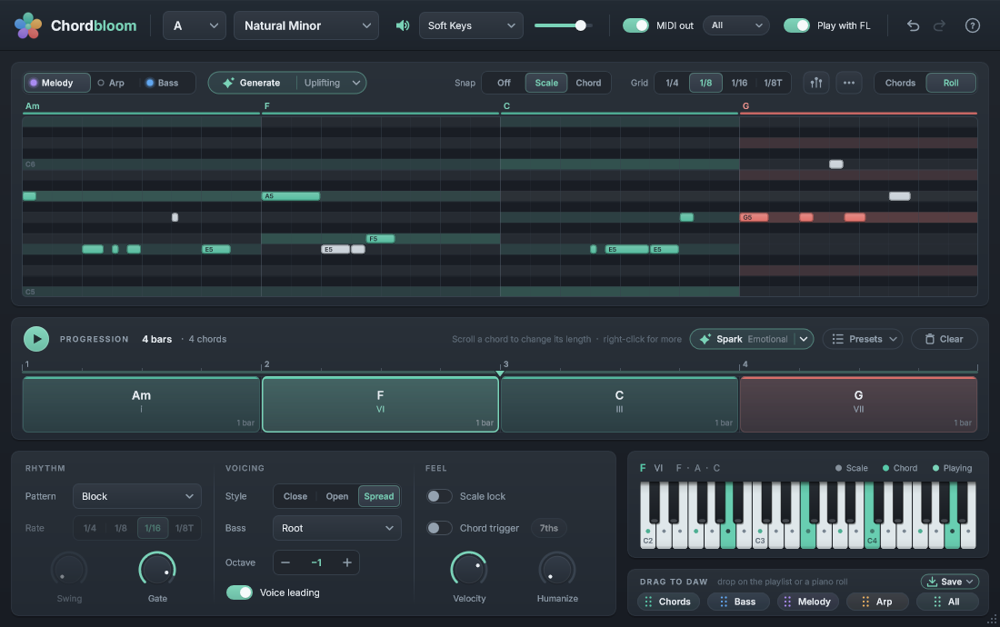

# Chordbloom

A chord-progression plugin for producers, inspired by Klimper. Pick a key and you get a palette of chords that fit it:
plain, seventh, colour, borrowed and secondary-dominant chords. Chordbloom glows on the chords that sound good next,
helps you build a progression with rhythm, bass and voice leading, lets you draw a melody over it in a piano roll that
lights up the notes that fit, plays it all with a built-in sound, and lets you drag the result into FL Studio as MIDI.

VST3 + CLAP + Standalone, Windows, built with JUCE 8.



## Install

1. Build it, or use the build that's already in `build\` (see *Building* below).
2. Copy it into the system plugin folders. Run this from the `Klimper-Like` folder in PowerShell; it asks for admin once:

   ```
   powershell -ExecutionPolicy Bypass -File scripts\install-plugin.ps1
   ```

   This copies `Chordbloom.vst3` to `C:\Program Files\Common Files\VST3\` and `Chordbloom.clap` to
   `C:\Program Files\Common Files\CLAP\`.
   No admin? Copies already sit in `%LOCALAPPDATA%\Programs\Common\VST3` and `...\CLAP`. Add those folders in FL's
   *Options > Manage plugins > Plugin search paths*.
3. In FL Studio: *Options > Manage plugins > Find installed plugins*, then add **Chordbloom** from the Channel Rack `+`
   menu. Use the VST3 by default. If MIDI out to other synths doesn't work, try the CLAP version (see below).

## Using it in FL Studio

The **?** button in the top-right corner shows the same instructions inside the plugin.

1. **Hear it right away.** Click a pad to hear it, double-click it (or drag it) into the progression, and press Play.
   The speaker icon, tone menu and volume control the built-in sound (Soft Keys, Warm Pad, Glass Pluck).
2. **Play it on your own synth (MIDI out).** In Chordbloom's FL wrapper, open *Settings (gear) > MIDI* and set *Output
   port* to a number, e.g. 1. In your synth's wrapper, set *MIDI > Input port* to the same number. Then click
   Chordbloom's speaker icon to turn its own sound off.
   *MIDI out part* (next to the MIDI out switch) sends *All* parts (chords on channel 1, bass on 2, melody on 3), *Chords
   + Bass*, or the chords, the bass or the melody alone. To put a part on a separate synth, clone the Chordbloom channel
   and set the clone's part (for example *Bass* or *Melody*).
   I couldn't test whether FL forwards VST3 MIDI output on your machine. If nothing arrives, load the **CLAP** version,
   or use option 3.
3. **Drag it into FL.** Drag the **Chords / Bass / Both / Melody** chips (bottom right) onto the playlist, a channel or
   the piano roll. You can also drag a single pad or a single progression block straight out of the plugin.
   *Both* is a two-track file (chords and bass), so it is best dropped on the playlist. *Melody* is one loop of the melody.
4. **Write a melody.** Click **Melody** in the switch at the top right of the chord palette. See *Melody* below.

**Play with FL** (top bar) loops the progression in time with FL's transport. Turn it off once the MIDI is in your
project, otherwise you'll hear the chords twice. Chordbloom shows a reminder after a drag.

## What's inside

- **Palette**: 5 rows (Triads, Sevenths, Color, Borrowed, Secondary) for 12 keys x 9 scales (major, natural, harmonic and
  melodic minor, and the modes). Colours show harmonic function: teal = tonic, amber = subdominant, coral = dominant,
  lavender = borrowed, blue = secondary dominant. Hover a pad for a short explanation.
  Extended colours: add9, 6, 6/9, maj9, m9, m11, maj7#11, 13, 7b9, sus.
- **Suggestions**: pads glow when they make a good next chord after the selected or last chord. The dots mark the top
  picks. With an empty progression, the glow shows good opening chords. The weights blend functional harmony with
  statistics from 349 modern producer MIDI files (minor-key aeolian motion, heavy use of colour chords, borrowed
  bVI/bVII in major).
- **Spark and Presets** (progression header): *Spark* writes a new progression in a chosen mood (Uplifting, Emotional,
  Dark, Dreamy, Epic, Lo-fi), and every click gives a different one. *Presets* lists well-known progressions resolved in
  your key. Both are undoable.
- **Progression lane**:
  - Drag pads in. Drop a pad on the middle of a block to replace that chord, or near an edge to insert.
  - Drag blocks to reorder them, scroll on a block to change its length, or drag its right edge.
  - Right-click a block for *Change to*, *Suggested here*, length, inversion (slash chords), octave, transpose,
    duplicate and delete.
  - When the chords fit another key better, *Move chords to <key>* appears.
- **Rhythm and voicing**:
  - Patterns: Block, Strum, Pulse, Offbeat, three arps and Broken, with rate, swing, gate, velocity and humanize.
  - Voicings: Close, Open (drop-2) and Spread, with automatic voice leading.
  - Bass line: Root, Root + 5th, Octaves or Pulse. It is voice-led and respects slash chords.
- **Live MIDI input**: *Scale lock* snaps your notes to the key. *Chord trigger* turns the white keys C–B into the key's
  chords I–VII (or 7ths).
- **Keyboard guide**: highlights scale tones, the current chord's notes (spelled correctly) and whatever is sounding.
- **Melody** (the "harmonic guide" piano roll, *Chords | Melody* switch at the top right of the palette):
  - The roll sits right above the progression and its beats line up with the chord blocks. Each row is a note. The
    key's notes are lighter, and over each chord its tones light up in the chord's colour (the root more strongly).
  - Click to draw a note, drag it to move it, drag its right edge to resize it, and right-click it to delete it (a
    right-drag deletes every note it crosses). Hold Alt for no grid. The mouse wheel scrolls up and down.
  - *Snap* keeps notes on the harmony: *Scale* (the key's notes, plus the chord's own tones, e.g. G# over E7 in A minor),
    *Chord* (only the tones of the chord under the note) or *Off*. *Grid* sets the step (1/4, 1/8, 1/16, 1/8T).
  - Notes are coloured by what they are: the chord's colour for chord tones, light for other notes of the key, grey for
    notes outside it. Drawn and dragged notes play so you can hear them.
  - The melody plays with the progression (built-in sound, MIDI channel 3). *Play* in the roll mutes it. It is saved
    with the project, and Undo / Redo cover it together with the chords.
  - Reordering, inserting, duplicating, deleting or resizing chords moves their melody notes with them. Spark, presets
    and Clear leave the melody where it is; notes past the end of the progression are kept (shown dimmed) but don't play.
  - Right-click empty space for Snap, Grid, Octave up / down and Clear.
  - **Ghost notes**: with several Chordbloom instances in one project, each roll shows the others' melodies as faint
    outlines (the *Ghosts* button turns them off), so a lead and a counter-melody or bass line don't collide.

## Building

You need Visual Studio 2022 with *Desktop development with C++*, plus CMake and Ninja (`pip install cmake ninja`).
JUCE 8.0.16 goes in `third_party/JUCE`:

```
git clone --depth 1 --branch 8.0.16-security https://github.com/juce-framework/JUCE.git third_party/JUCE
scripts\fetch_clap.bat
scripts\build.bat build Chordbloom_VST3 Chordbloom_CLAP Chordbloom_Standalone CoreTests ChordbloomDev
```

`fetch_clap.bat` adds the optional CLAP build. Then run the checks:

- `build\CoreTests.exe`: music-theory, voicing, generator and melody unit tests
- `build\ChordbloomDev_artefacts\Release\ChordbloomDev.exe selftest`: processor and editor integration tests
- `build\ChordbloomDev_artefacts\Release\ChordbloomDev.exe snapshot out\snaps`: renders the UI to PNGs
- `tools\pluginval\pluginval.exe --strictness-level 10 --validate build\Chordbloom_artefacts\Release\VST3\Chordbloom.vst3`

See `ARCHITECTURE.md` for how the code is organised.

## Licences

- JUCE 8: AGPLv3 or the JUCE licence. Fine for personal use; check the JUCE terms before you distribute builds.
- Inter font: SIL Open Font License 1.1.
- clap-juce-extensions: MIT.
- The logo was generated for this project.
